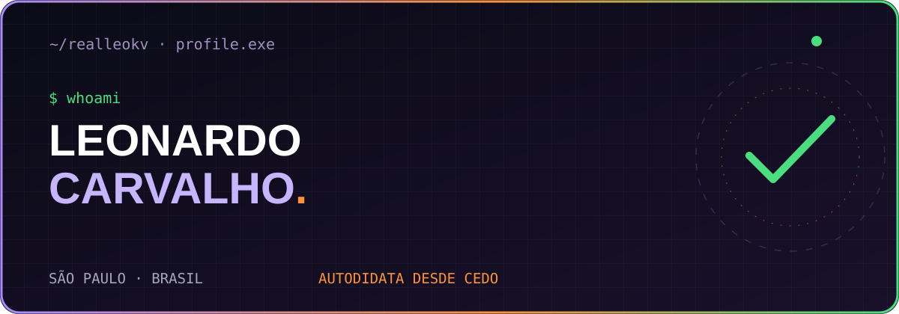
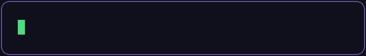
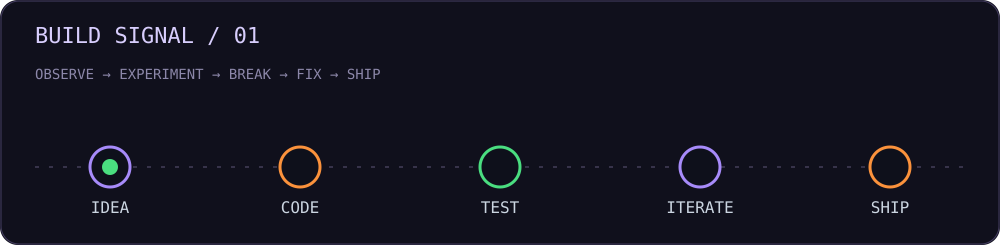

<div align="center">



[](https://github.com/realleokv)

[](https://github.com/realleokv)


**`code.` `create.` `break.` `learn.` `repeat.`**

[Explorar projetos](#-projetos-em-destaque) · [Conhecer o dev](#-quem-est%C3%A1-por-tr%C3%A1s-do-c%C3%B3digo) · [Falar comigo](#-contato)

</div>

---

## 👋 Hello World, eu sou o **Leonardo Carvalho**

🎯 **15 anos** — **Zona Leste, São Paulo, SP**  
🧠 Desenvolvedor **autodidata** focado em Python, automações e desenvolvimento web.  
💻 Estudante de **Informática** no Ensino Médio Técnico do **SENAC São Miguel Paulista**.  
🚀 Sempre criando projetos, aprendendo algo novo e transformando ideias em código.



## 🛠️ Tecnologias que eu uso

<div align="center">


</div>

```python
class LeonardoCarvalho:
    location = "Zona Leste, São Paulo 🇧🇷"
    education = "Ensino Médio Técnico em Informática | SENAC"
    focus = ["Python", "Automações", "Desenvolvimento Web"]
    learning = True

    def build(self, idea):
        return f"Transformando {idea} em código, uma versão por vez."
```

## 📌 Quem está por trás do código?

- 🔥 Aprendo programação por conta própria desde cedo.
- 💡 Gosto de desenvolver sites, sistemas e automações.
- 🧩 Curto desafios de lógica e programação.
- 📈 Estou construindo minha carreira na área de tecnologia.
- 🎨 Gosto de juntar **design, criatividade e programação** em projetos úteis.

<details>
<summary><b>🕹️ ABRIR / dev-console — informações adicionais</b></summary>
<br>

```text
$ leo --interests
> interfaces web
> visão computacional
> automação e lógica
> projetos autorais
> experimentar novas ideias

$ leo --philosophy
> Se eu ainda não sei fazer, posso aprender construindo.
```

**Missão secundária:** explorar meus repositórios e encontrar algo novo. [Abrir inventário →](https://github.com/realleokv?tab=repositories)

</details>

## ⚡ Atualmente

| Processo | Status |
| :--- | :--- |
| 🧠 Estudando | Python avançado, JavaScript e desenvolvimento web |
| 🧪 Criando | Projetos pessoais e sistemas para portfólio |
| 🎯 Objetivo | Evoluir como desenvolvedor full stack |
| 🔁 Metodologia | Aprender, construir, testar e melhorar |



## 🚀 Projetos em destaque

> Alguns projetos que representam minha curiosidade por tecnologia. Explore os repositórios para conferir código, documentação e o estágio atual de cada um.

<table>
<tr>
<td width="50%" valign="top">

### 🤟 Libras Vision / Datilologia
Visão computacional e reconhecimento de sinais com Python e MediaPipe.

**`Python` `MediaPipe` `Flask`**

[Ver projeto →](https://github.com/realleokv/teste)
</td>
<td width="50%" valign="top">

### 🥁 Air Drums
Experimento de bateria virtual: interação com as mãos, câmera e pads digitais.

**`Python` `Computer Vision` `Web`**

[Explorar repositórios →](https://github.com/realleokv?tab=repositories)
</td>
</tr>
<tr>
<td width="50%" valign="top">

### 🛍️ Bhagya Collection
Experiência de loja autoral com foco em interface, identidade e e-commerce.

**`Web` `UI/UX` `Design`**

[Explorar repositórios →](https://github.com/realleokv?tab=repositories)
</td>
<td width="50%" valign="top">

### 🧠 Laboratório de ideias
Protótipos, automações, experiências e códigos que ainda estão evoluindo.

**`Experimentos` `Open Source`**

[Ver laboratório →](https://github.com/realleokv?tab=repositories)
</td>
</tr>
</table>

<details>
<summary><b>🔎 INSPECIONAR / como eu penso um projeto</b></summary>
<br>

1. **Problema:** o que queremos resolver ou experimentar?
2. **Protótipo:** qual é a menor versão que já funciona?
3. **Iteração:** quais erros e limitações apareceram?
4. **Experiência:** como torná-lo mais útil, bonito e acessível?
5. **Entrega:** documentar, publicar e melhorar.

</details>

## 📊 GitHub / sinais de atividade

<div align="center">

[](https://github.com/realleokv)

[](https://github.com/realleokv?tab=repositories)

</div>

<details>
<summary><b>📂 ABRIR / atalhos de navegação</b></summary>
<br>

| Comando | Destino |
| --- | --- |
| `open --repos` | [Todos os repositórios](https://github.com/realleokv?tab=repositories) |
| `open --activity` | [Atividade pública](https://github.com/realleokv) |
| `open --instagram` | [Instagram @realleokv](https://instagram.com/realleokv) |

</details>

## 📫 Contato

<div align="center">

[](https://instagram.com/realleokv)
[](https://github.com/realleokv)

**`System.out.println("Até o próximo commit!");`**

<sub>Made with curiosity, code & ☕ · São Paulo, Brasil</sub>

</div>
